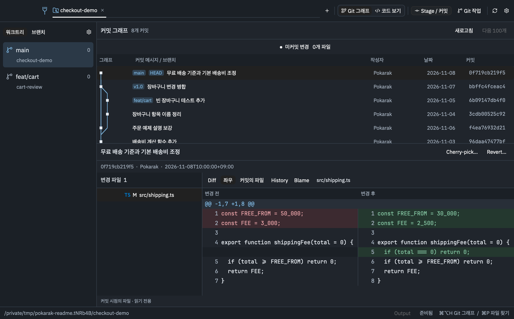

# 포카락 · Pokarak

포카락은 여러 Git 워크트리의 변경 사항을 검토하는 macOS 앱입니다. 커밋 그래프에서 변경된 코드를 읽고, 작업 중인 파일은 원하는 줄만 골라 커밋할 수 있습니다.

## 설치

Apple Silicon Mac(M1 이상), macOS 13 이상에서 터미널에 다음 명령을 붙여 넣으세요.

```sh
/bin/bash -o pipefail -c 'curl -fsSL https://github.com/dave915/pokarak/releases/latest/download/install.sh | /bin/bash'
```

Finder에서 `~/Applications/포카락.app`을 열고 **⌘O**로 Git 저장소를 선택하세요. 터미널에서는 저장소 폴더에서 `~/.local/bin/pokarak .`을 실행하면 됩니다.

업데이트할 때는 앱을 종료하고 `~/.local/bin/pokarak update`를 실행하세요. [릴리스 노트](https://github.com/dave915/pokarak/releases/latest)

## 주요 기능



- **커밋 그래프**에서 커밋을 선택하면 아래에 변경 파일과 diff가 열립니다. **좌우**를 누르면 수정 전후 코드가 나란히 보입니다.
- **History**로 파일의 변경 이력을 따라가고, **Blame**으로 각 줄을 마지막으로 수정한 커밋과 작성자를 확인합니다.
- **Stage / 커밋**에서 파일 전체, 변경 블록 또는 개별 줄을 선택해 커밋합니다. 브랜치 병합(Merge), 리베이스(Rebase), Stash도 앱에서 실행할 수 있습니다.
- **워크트리**를 만들거나 전환해 여러 브랜치의 작업을 오갈 수 있습니다. 각 워크트리는 열어 둔 파일과 읽던 위치를 기억합니다.

v0.1.2 이후 개발 버전에서는 그래프의 **미커밋 변경**에서 바로 커밋하고, 상단바의 **터미널** 버튼으로 해당 워크트리에서 zsh를 열어 AI CLI를 실행할 수 있습니다.

[설치 옵션](docs/distribution.md) · [코드 탐색 설정](docs/language-analysis.md) · [MIT 라이선스](LICENSE)
