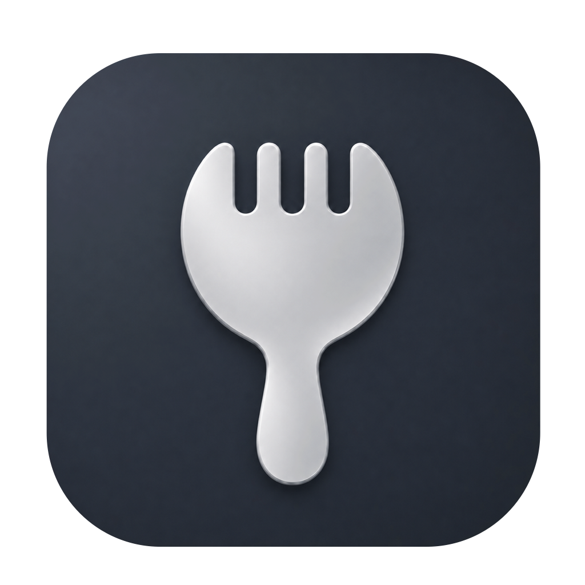
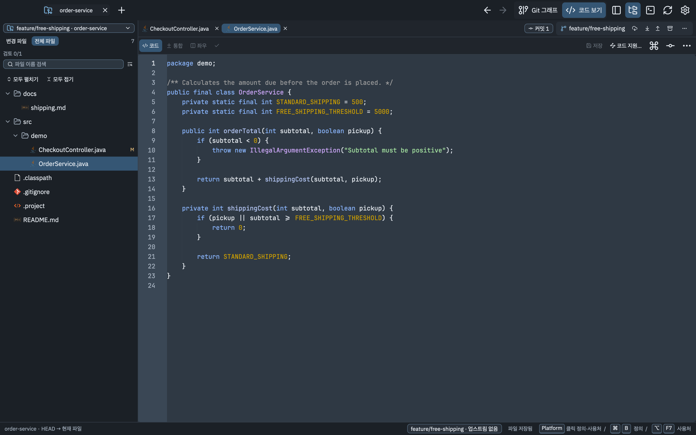
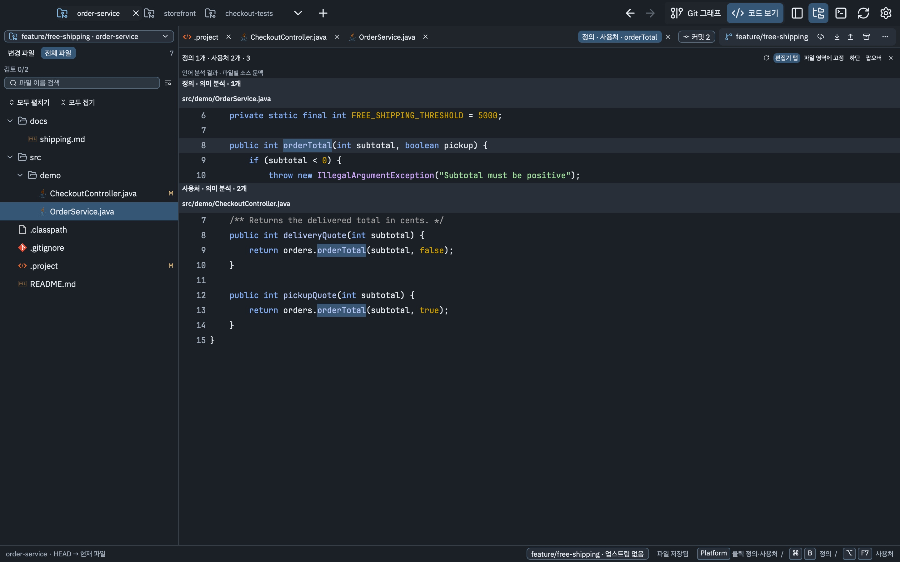
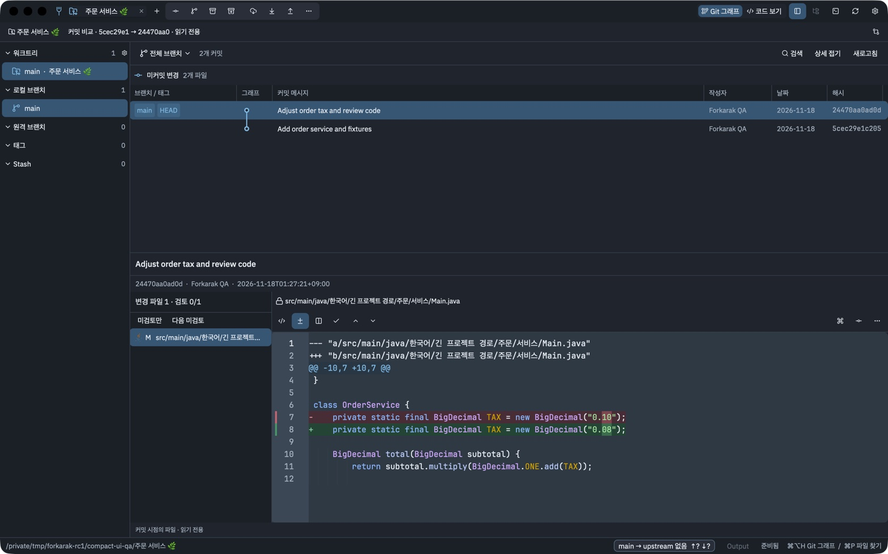
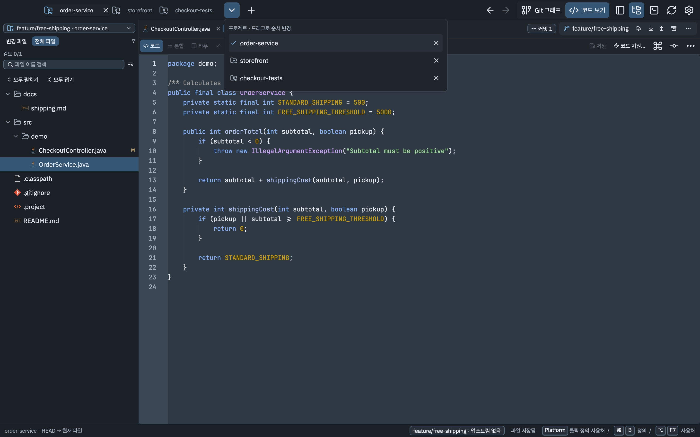

<h1 align="center"> Forkarak · 포카락</h1>

<p align="center">파일을 편집하고, Git 변경을 검토·커밋하고, 워크트리를 오가는 네이티브 macOS 작업 공간입니다.</p>

<p align="center"><a href="#설치와-실행"><strong>설치와 실행</strong></a> · <a href="https://github.com/dave915/Forkarak/releases/latest/download/Forkarak-macos-arm64.zip">공개 안정 버전 다운로드</a> · <a href="docs/language-analysis.md">언어 지원</a></p>



## 편집과 탐색

프로젝트를 열고 **코드 보기**에서 파일 트리와 빠른 파일 열기, 프로젝트 텍스트 검색을 사용하세요. 파일·폴더 생성과 이름 변경·이동, 주석 토글, 줄 이동·복제, 같은 단어 선택, 줄 번호 이동과 줄바꿈을 지원합니다. 파일 탭과 명령 모음은 작은 창에서 아이콘과 **더 보기** 메뉴로 바뀝니다.

현재 소스에서는 작업 트리의 텍스트 파일을 바로 편집하고 **저장** 또는 <kbd>⌘</kbd> <kbd>S</kbd>로 파일만 저장합니다. 공개 안정 버전 **v1.0.0**은 작업 파일을 읽기 전용으로 열며 **편집**으로 전환해야 합니다. 바이너리·삭제 파일·과거 커밋·외부 소스와 diff는 읽기 전용입니다. 저장과 Git 스테이징·커밋은 별도 동작입니다.

미저장 초안과 읽던 위치는 파일·워크트리별로 보관합니다. 외부 도구가 파일을 바꾸면 **디스크와 비교…**에서 원본·초안·현재 디스크를 확인하고 조정하세요. 조정 결과를 초안에 반영한 뒤 파일 저장을 직접 실행합니다. 외부 파일·커밋·참조 변경은 자동 갱신하며 입력이나 Git 작업 중에는 갱신을 보류합니다.

<kbd>⌘</kbd> 클릭으로 **정의**와 **사용처**를 찾고, 뒤로·앞으로 버튼으로 읽던 위치를 오갈 수 있습니다. **코드 지원…**에서 자동완성, 오류 확인, 파일 구조 검색, 함수 도움말, 타입·설명과 포맷을 요청하세요. 파일 보기는 언어 서버나 인덱싱을 기다리지 않으며 텍스트 후보와 의미 기반 결과를 구분합니다. 도구 설치와 프로젝트 분석 허용은 별개입니다. [언어별 지원 범위와 설정](docs/language-analysis.md)을 확인하세요.



## 그래프와 변경 검토

**Git 그래프**에서 브랜치·태그·커밋을 탐색하고 커밋을 선택해 변경 파일과 diff를 확인하세요. 통합/좌우 diff, 바뀐 단어 강조, 공백 변경 숨김, 변경 구간 이동, 파일 이력과 Blame을 제공합니다. **브랜치 비교…**는 공통 조상부터 현재 작업까지 비교하며 그래프의 브랜치 필터와 별도로 유지됩니다.

**검토 완료**로 확인한 파일을 표시하고 미검토 파일만 보거나 다음 파일로 이동할 수 있습니다. 파일 내용이나 비교 기준이 바뀌면 표시를 다시 확인합니다. **Stage / 커밋**에서 파일 여러 개, 블록 또는 줄을 선택해 스테이징하고 커밋하세요. 공백 표시 필터는 실제 패치를 바꾸지 않습니다.

브랜치 생성·이름 변경·추적, Fetch/Pull/Push, Stash Apply/Pop, Merge/Rebase, Cherry-pick/Revert는 대상과 내용을 확인한 뒤 직접 실행합니다. 진행 출력과 취소, 진행 중 작업의 Continue/Abort, 충돌의 Ours/Theirs/Base 비교와 저장·스테이징을 지원합니다. Reflog에서 복구 브랜치를 만들거나 마지막 커밋을 취소하면서 작업 파일을 유지할 수 있습니다. Clone/Init, 태그와 `.gitignore` 편집도 제공하며 단순 조회나 워크트리 탐색은 저장소를 변경하지 않습니다.



## 프로젝트와 워크트리

상단 프로젝트 탭과 펼친 프로젝트 목록에서 드래그로 순서를 바꿀 수 있습니다. 탭이 넘치면 가로로 이동하거나 목록에서 선택하세요. 프로젝트와 워크트리마다 파일 탭·초안·읽던 위치·검색·패널 상태를 유지합니다.

사이드바는 <kbd>⌘</kbd> <kbd>⌥</kbd> <kbd>B</kbd>, 파일 목록은 <kbd>⌘</kbd> <kbd>⇧</kbd> <kbd>B</kbd>로 접고 펼칠 수 있습니다. **설정 → 모양·시작 화면**에서 기본 작업 화면을 에디터 또는 Git로 선택하고 마지막 작업 복원을 별도로 설정하세요.



## 터미널, 작업과 AI 도구

내장 터미널에서 워크트리별로 여러 세션을 열고 탭을 전환·종료·재시작할 수 있습니다. 패널을 숨겨도 세션은 유지됩니다. **AI 도구** 설정에서 Claude/Codex CLI와 인자를 정하고 현재 워크트리의 터미널로 실행하거나 명령을 복사하세요. 계정과 CLI 설치는 각 도구의 요구 사항을 따릅니다.

저장한 작업 프로필을 실행·중지·재시작하고 로그를 검색하거나 스택 트레이스에서 파일로 이동할 수 있습니다. Spring 작업의 Gradle/Maven 실행, 프로젝트 JDK·프로필·환경 변수도 설정에서 관리합니다.

## 설정

모양·시작 화면, 에디터·들여쓰기, 언어 분석, 탐색·검색, Git·검토, 키보드, 터미널·실행, AI, 확장과 업데이트를 범주별로 설정하세요. UI/코드/터미널 글자 크기와 배율, 테마, 단축키·충돌 검사, 검색 제외와 프로젝트별 재정의를 제공합니다. 상태는 작업 중인 저장소 밖에 저장합니다.

## 설치와 실행

Apple Silicon Mac(M1 이상), macOS 13 이상이 대상입니다. 위의 **공개 안정 버전 다운로드** 링크를 사용하거나 아래 명령으로 설치하세요.

```sh
/bin/bash -o pipefail -c 'curl -fsSL https://github.com/dave915/Forkarak/releases/latest/download/install.sh | /bin/bash'
```

설치한 `Forkarak.app`을 열어 프로젝트를 선택하세요. 앱의 업데이트 알림 또는 `forkarak update`로 공개 릴리스 업데이트를 설치할 수 있습니다. [소스 실행·빌드, macOS 패키징과 배포 안내](docs/distribution.md)도 참고하세요.

## CLI 사용

앱 번들에서 `forkarak`과 `fkk` 명령을 함께 설치할 수 있습니다. 앱을 `~/Applications/Forkarak.app`에 둔 경우:

```sh
~/Applications/Forkarak.app/Contents/MacOS/forkarak install-cli
```

`~/.local/bin`을 PATH에 추가한 뒤 프로젝트, 파일 또는 줄 위치를 여세요.

```sh
fkk .
forkarak src/order-service.ts
fkk --goto src/order-service.ts:24:5
```

CLI 파일 열기는 기존 Git 워크트리 안의 존재하는 파일을 대상으로 합니다. Git 밖 단독 파일과 새 파일 생성은 지원하지 않습니다. `--reuse-window`, `--new-window`, 자동화용 `--background` 등은 [CLI 옵션과 설치 안내](docs/distribution.md)를 참고하세요.

AI 도구나 스크립트에서는 JSON 인터페이스로 상태와 파일 내용을 조회할 수 있습니다.

```sh
forkarak ctl status --repo .
forkarak ctl files --repo . --changed
forkarak ctl read --repo . --path src/main.rs
forkarak ctl instructions --agent codex
forkarak ctl sessions
```

저장·Stage·Commit·Merge는 `ctl`에서도 명시적인 `--yes`가 필요합니다. 전체 명령은 `forkarak ctl --help`를 참고하세요.

[언어 지원과 제한](docs/language-analysis.md) · [설치·CLI·배포](docs/distribution.md) · [MIT 라이선스](LICENSE)
