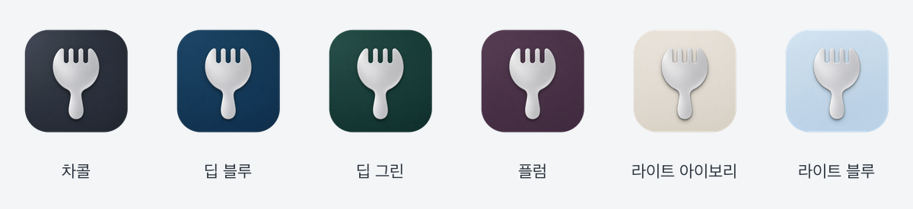

<h1 align="center"> Forkarak · 포카락</h1>

<p align="center">코드를 읽고 고치고, 변경을 검토해 커밋하고, 워크트리를 오가는 네이티브 macOS 코드 에디터·Git 작업 공간입니다. Rust와 GPUI로 만들었습니다.</p>

<p align="center"><a href="#설치와-실행"><strong>설치와 실행</strong></a> · <a href="https://github.com/dave915/Forkarak/releases/latest/download/Forkarak-macos-arm64.zip">공개 안정 버전 다운로드</a> · <a href="docs/language-analysis.md">언어 지원</a></p>


*아래 기능은 Forkarak 1.0.0에 포함됩니다. 실제 앱 화면이며, 편집기 비교의 버전·촬영 조건은 아래 기록을 참고하세요.*

[VS Code·Zed와 같은 파일을 연 실제 화면 비교·촬영 조건](docs/images/editor-comparison/findings.md)

## 코드와 탐색

**코드 보기**에서 파일 트리, 빠른 파일 열기, 프로젝트 텍스트 검색과 뒤로·앞으로 탐색을 사용하세요. 파일 탭과 한 줄 명령 모음은 작은 창에서 아이콘과 **더 보기** 메뉴로 바뀝니다. 파일·폴더 생성, 이름 변경·이동, 주석 토글, 줄 이동·복제, 일치 단어 선택, 줄 이동과 자동 줄바꿈도 제공합니다.

작업 파일은 기본적으로 **읽기 전용 → 편집 → 저장 / ⌘S** 순서로 수정합니다. **설정 → 에디터·들여쓰기 → 파일 열기 모드**에서 바로 편집하도록 선택할 수 있습니다. Vim 키맵은 사용하지 않습니다. 시작 화면은 별도로 **설정 → 모양·시작 화면 → 기본 작업 화면**에서 에디터/Git를 선택하며, 기본값은 Git입니다. 마지막 작업 복원은 별도 설정입니다. 과거 커밋 파일은 항상 읽기 전용입니다.

**코드 지원…**에서 자동완성, 오류 확인, 파일 구조 검색, 함수 도움말과 타입·설명을 요청하세요. 정의·사용처·구현 탐색, 포맷과 미저장 버퍼 분석은 서버의 실제 지원 범위를 따릅니다. 파일 보기는 서버나 인덱싱을 기다리지 않으며, 텍스트 검색 결과를 의미 기반 참조라고 표시하지 않습니다.

기본 macOS 패키지에는 Java 서버와 Temurin 런타임이 포함됩니다. Kotlin을 비롯한 추가 언어 도구는 **언어 지원 관리**에서 설치·상태 확인·업데이트·취소·재시도할 수 있습니다. 서버 런타임에 사용자 Homebrew/npm 설치가 필요하지 않습니다. 도구 설치와 프로젝트 분석·가져오기 허용은 별개입니다. [언어별 실제 검증 범위와 사용자 지정 설정](docs/language-analysis.md)을 확인하세요.

미저장 초안은 저장소 밖에 파일·워크트리별로 보관합니다. 외부 도구가 파일을 바꾸면 조용히 덮어쓰지 않고 **디스크와 비교…**에서 원본·초안·현재 디스크를 조정합니다. 조정 결과 반영과 실제 저장도 분리합니다. 외부 파일·커밋·참조 변경은 자동 갱신하며, 읽던 위치·초안을 유지하고 입력이나 Git 작업 중에는 안전하게 갱신을 보류합니다.

## 그래프, 검토와 Git 작업

커밋 그래프에서 브랜치·태그·이력을 탐색하고 커밋을 고르면 변경 파일과 diff가 열립니다. 통합/좌우 diff, 바뀐 단어 강조, 공백 변경 숨김, 변경 구간 이동, 파일 이력과 Blame을 제공합니다. **브랜치 비교…**는 공통 조상부터 현재 작업까지 비교하며 그래프 필터와 별도로 유지됩니다.

**검토 완료**는 파일 내용·워크트리·비교 기준을 확인해 저장합니다. 내용이 바뀌면 표시를 해제하고, 미검토 파일만 보거나 다음 파일로 이동할 수 있습니다. **Stage / 커밋**에서는 파일 여러 개, 블록 또는 줄을 선택해 스테이징합니다. 표시용 공백 필터는 실제 패치를 바꾸지 않습니다.

브랜치 생성·이름 변경·추적, Fetch/Pull/Push, Stash Apply/Pop, Merge/Rebase, Cherry-pick/Revert를 명시적으로 실행합니다. 대상 미리보기, 진행 출력·취소, 진행 중 작업의 Continue/Abort, 충돌의 Ours/Theirs/Base 비교와 명시적 저장·스테이징을 지원합니다. Reflog에서 복구 브랜치를 만들고, 마지막 커밋을 취소할 때 작업 파일을 유지할 수 있습니다. Clone/Init, 태그와 `.gitignore` 편집도 작업 대상을 확인한 뒤 실행합니다. 단순 조회나 워크트리 탐색이 저장소를 변경하지 않습니다.


*작성한 예제 저장소에서 커밋을 선택한 화면입니다. 그래프와 과거 diff에도 한 줄 명령 모음을 사용합니다.*

## 워크트리, 터미널과 AI

상단 프로젝트 탭과 펼친 프로젝트 목록에서 드래그로 순서를 바꿀 수 있습니다. 두 곳의 순서는 함께 바뀌며 재시작 후에도 유지됩니다. 탭이 넘치면 가로로 이동하거나 목록에서 선택할 수 있습니다.


프로젝트 탭과 워크트리마다 파일 탭·초안·읽던 위치·검색·패널 상태를 유지합니다. 워크트리를 전환할 때 다른 작업의 늦은 응답을 섞지 않습니다. 사이드바와 파일 목록은 각각 **⌘⌥B**, **⌘⇧B**로 접고 펼칠 수 있습니다.

내장 터미널은 워크트리별 여러 세션, 탭 전환·종료·재시작과 로그인 셸 설정을 지원합니다. 패널을 숨겨도 세션은 유지됩니다. **AI 도구** 설정에서 Claude/Codex CLI와 인자를 정하고, 현재 워크트리의 터미널로 실행하거나 명령을 복사하세요. 별도 AI 계정이나 CLI 설치는 각 도구의 요구 사항을 따릅니다.

저장한 작업 프로필의 실행·중지·재시작, 검색 가능한 로그와 스택 트레이스의 파일 이동을 제공합니다. 확장 API는 명령·설정·포맷터·언어 서버를 연결하며 별도 프로세스로 실행합니다. OS 샌드박스를 뜻하지 않습니다. Spring 확장은 Gradle/Maven 작업, 프로젝트 JDK·프로필·환경 변수와 로그 탐색을 지원합니다. Spring Properties의 의미 분석 브리지는 아직 포함하지 않습니다.

## 모양과 설정

모양·시작 화면, 에디터·들여쓰기, 언어 분석, 탐색·검색, Git·검토, 키보드, 터미널·실행, AI, 확장, 업데이트를 범주별로 설정하세요. UI/코드/터미널 글자 크기와 배율, 테마, 단축키·충돌 검사, 검색 제외와 프로젝트별 재정의를 제공합니다. 상태는 검사 중인 저장소 밖에 저장합니다.



*여섯 앱 아이콘 배경과 **기본값 따르기**를 제공합니다. 선택은 앱 공통으로 저장해 Dock에 적용하며, 기본값 따르기는 이후 번들 교체의 기본 아이콘을 따릅니다. 색상별 Finder 아이콘 교체 기능은 아닙니다.*

## 설치와 실행

Apple Silicon Mac(M1 이상), macOS 13 이상이 대상입니다. 공개 안정 버전은 아래 명령이나 위 다운로드 링크로 설치합니다. **1.0.0에는 위 에디터·Git·언어 관리 기능과 두 CLI 명령이 포함됩니다.**

```sh
/bin/bash -o pipefail -c 'curl -fsSL https://github.com/dave915/Forkarak/releases/latest/download/install.sh | /bin/bash'
```

소스 빌드에는 Rust와 Apple 개발 도구가 필요합니다. 프로젝트 루트에서 실행하세요. 패키징은 Java 리소스도 준비하므로 첫 실행에 네트워크와 빌드 머신의 Python 3가 필요합니다.

```sh
cargo run -p pokarak -- /absolute/path/to/git-project
./scripts/package-macos.sh
```

결과는 `dist/Forkarak.app`입니다. 원하는 위치에 둔 뒤 현재 번들에서 두 CLI 별칭을 함께 설치할 수 있습니다. 예를 들어 `~/Applications/Forkarak.app`에 둔 경우:

```sh
~/Applications/Forkarak.app/Contents/MacOS/forkarak install-cli
~/.local/bin/fkk .
~/.local/bin/forkarak src/order-service.ts
~/.local/bin/fkk --goto src/order-service.ts:24:5
```

`~/.local/bin`을 PATH에 추가하면 `forkarak`, `fkk`로 실행할 수 있습니다. CLI 파일 열기는 기존 Git 워크트리 안의 존재하는 경로를 대상으로 합니다. Git 밖 단독 파일·새 파일 생성은 지원하지 않습니다. `--reuse-window`, `--new-window`, 자동화용 `--background` 등은 [CLI 옵션과 설치·업데이트 문서](docs/distribution.md)를 참고하세요.

Claude/Codex 등에서 사용하는 JSON 인터페이스도 있습니다.

```sh
forkarak ctl status --repo .
forkarak ctl files --repo . --changed
forkarak ctl read --repo . --path src/main.rs
forkarak ctl instructions --agent codex
forkarak ctl sessions
```

저장·Stage·Commit·Merge는 `ctl`에서도 명시적인 `--yes`가 필요합니다. 전체 명령은 `forkarak ctl --help`를 참고하세요. 공개 릴리스 업데이트는 앱의 업데이트 알림 또는 `forkarak update`로 수행합니다.

[언어 지원과 제한](docs/language-analysis.md) · [설치·CLI·배포](docs/distribution.md) · [MIT 라이선스](LICENSE)
