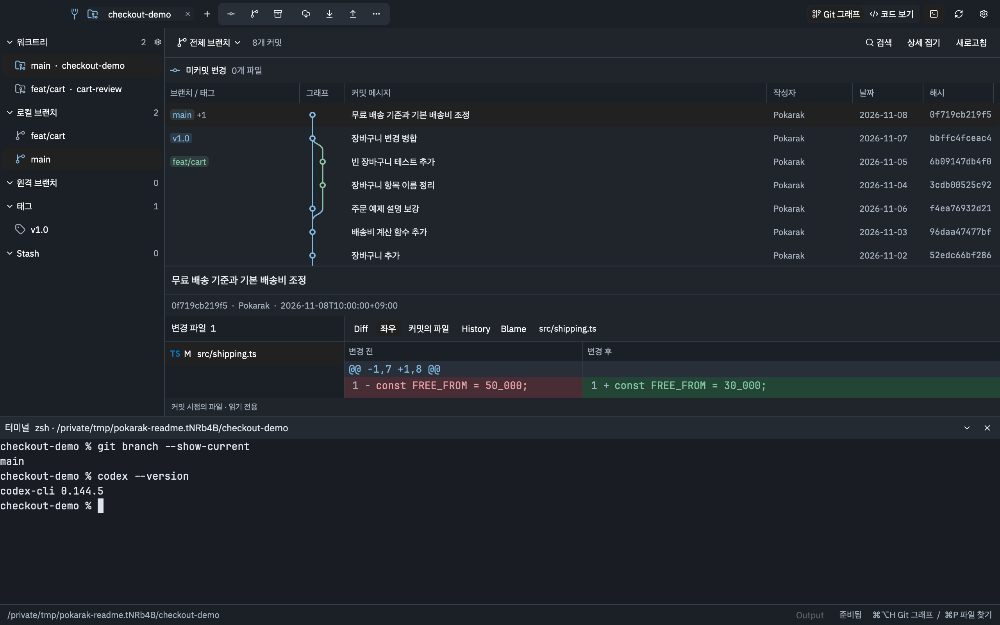

<h1 align="center"> 포카락 · Pokarak</h1>

<p align="center">여러 워크트리의 변경 사항을 커밋 그래프에서 살펴보고, 원하는 줄만 골라 커밋하는 macOS용 Git 클라이언트입니다.</p>

<p align="center"><a href="#설치"><strong>macOS 설치 방법</strong></a> · <a href="https://github.com/dave915/pokarak/releases/latest/download/Pokarak-macos-arm64.zip">Pokarak.app 다운로드</a> · <a href="https://github.com/dave915/pokarak/releases/latest">최신 릴리스</a></p>


*포카락 v0.2.4에서 배송비 변경 커밋을 선택한 화면입니다.*

## 설치

Apple Silicon Mac(M1 이상), macOS 13 이상에서 터미널에 다음 명령을 붙여 넣으세요.

```sh
/bin/bash -o pipefail -c 'curl -fsSL https://github.com/dave915/pokarak/releases/latest/download/install.sh | /bin/bash'
```

기존에 `포카락.app`으로 설치했다면 앱을 종료하고 위 설치 명령을 한 번 실행하세요. 같은 위치의 앱 이름이 `Pokarak.app`으로 바뀝니다.

`~/Applications/Pokarak.app`을 열고 **⌘O**로 저장소를 선택하세요. 터미널에서는 저장소 폴더에서 `~/.local/bin/pokarak .`으로 열 수 있습니다. 업데이트할 때는 앱을 종료한 뒤 `~/.local/bin/pokarak update`를 실행하세요. v0.2.1 이하에서 업데이트가 403으로 멈추면 앱을 종료한 뒤 위 설치 명령을 다시 실행하세요.

## 주요 기능

### 커밋 그래프와 코드 비교

그래프의 **전체 브랜치**에서 로컬·원격 브랜치를 검색해 해당 이력만 볼 수 있습니다. 목록 아래로 스크롤하면 다음 커밋을 100개씩 불러옵니다. 열 제목의 오른쪽 경계를 드래그하면 열 너비를 조절할 수 있습니다.

커밋을 고르면 변경 파일과 diff가 열립니다. **Diff**와 **좌우**로 비교 방식을 바꾸고, **History**로 파일 이력을, **Blame**으로 각 줄을 마지막으로 수정한 사람과 커밋을 확인하세요. 추가된 줄은 초록색과 `+`, 삭제된 줄은 붉은색과 `−`로 표시합니다. 좌우 diff의 가운데 경계를 드래그하면 양쪽 너비가 바뀝니다.

**설정**에서 인터페이스 글자 크기, 코드·Diff 글자 크기, 화면 배율을 각각 조절할 수 있습니다.


### 워크트리와 터미널

왼쪽 목록에서 워크트리를 만들고 전환하세요. 상단의 **터미널**(`>_`) 버튼을 누르면 앱 하단에 해당 워크트리의 로그인 zsh가 열립니다. 평소 zsh에 설정한 PATH와 환경 변수로 `codex` 등 설치해 둔 AI CLI를 실행하세요. 버튼을 다시 눌러 패널을 숨겼다가 열어도 셸 세션이 이어집니다.



### 스테이징과 브랜치 작업

**Stage / 커밋**에서 파일 전체, 변경 블록 또는 개별 줄을 골라 커밋하세요. 상단 툴바에서 Fetch·Pull·Push와 Stash를 실행하고, 브랜치 메뉴에서 Merge·Rebase를 시작할 수 있습니다.

[설치 옵션](docs/distribution.md) · [코드 탐색 설정](docs/language-analysis.md) · [MIT 라이선스](LICENSE)
