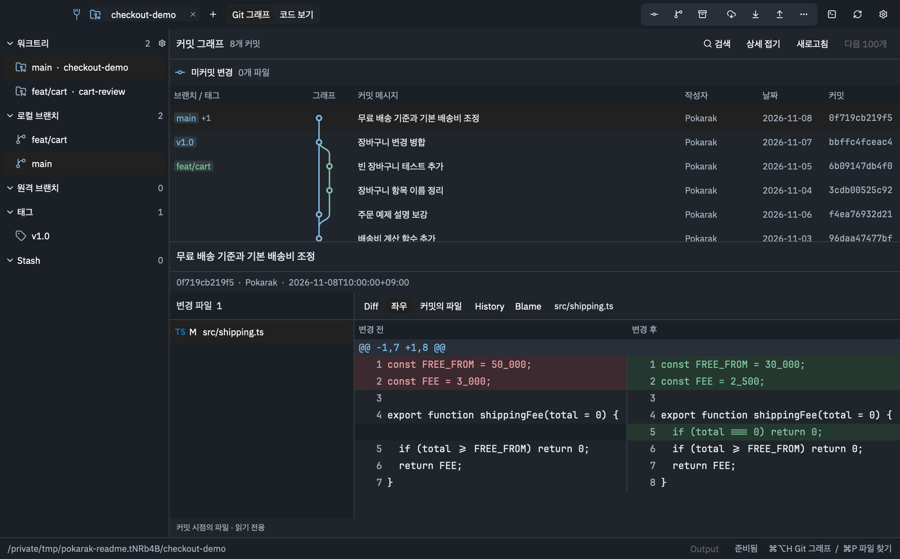
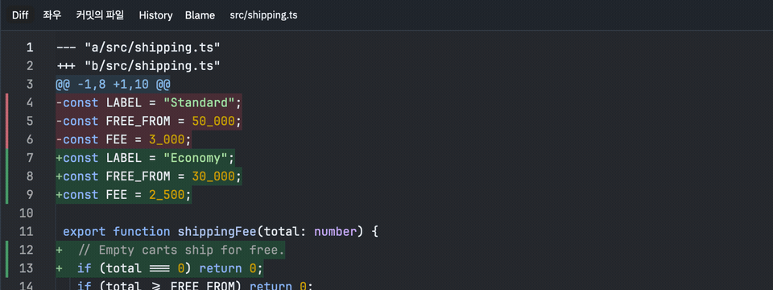

<h1 align="center"> Forkarak · 포카락</h1>

<p align="center">Forkarak은 커밋 그래프에서 브랜치와 워크트리를 탐색하고, 변경 전후를 비교해 원하는 줄만 커밋할 수 있는 macOS용 Git 클라이언트입니다.</p>

<p align="center"><a href="#설치"><strong>macOS 설치 방법</strong></a> · <a href="https://github.com/dave915/Forkarak/releases/latest/download/Forkarak-macos-arm64.zip">Forkarak.app 다운로드</a> · <a href="https://github.com/dave915/Forkarak/releases/latest">최신 릴리스</a></p>



*Forkarak v0.2.7에서 배송 옵션을 수정한 커밋을 선택해 TypeScript 파일의 변경 전후를 비교하는 화면입니다.*

## 설치

Apple Silicon Mac(M1 이상), macOS 13 이상에서 터미널에 다음 명령을 붙여 넣으세요.

```sh
/bin/bash -o pipefail -c 'curl -fsSL https://github.com/dave915/Forkarak/releases/latest/download/install.sh | /bin/bash'
```

설치 후 `~/Applications/Forkarak.app`을 열고 **⌘O**로 저장소를 선택하세요. 터미널에서는 저장소 폴더에서 `~/.local/bin/forkarak .`을 실행하세요. 이전 `Pokarak.app`을 사용했다면 위 명령으로 Forkarak을 새로 설치할 수 있습니다.

앱을 사용하는 동안 새 버전이 나오면 창에 알림이 표시됩니다. **업데이트 다운로드**를 누르고 작업을 계속하세요. 준비가 끝나면 **업데이트하고 재시작**을 눌러 보고 있던 워크트리로 돌아갈 수 있습니다. **설정 → 업데이트 확인**으로 직접 확인할 수도 있습니다.

## 주요 기능

### 커밋 그래프와 코드 비교

그래프의 **전체 브랜치**에서 로컬·원격 브랜치를 검색해 해당 이력만 볼 수 있습니다. 목록 아래로 스크롤하면 다음 커밋을 100개씩 불러옵니다. 열 제목의 오른쪽 경계를 드래그하면 열 너비를 조절할 수 있습니다.

커밋을 고르면 변경 파일과 diff가 열립니다. **Diff**는 변경을 한 줄씩 보여주고, **좌우**는 변경 전후를 나란히 보여줍니다. 가운데 경계를 드래그해 더 보고 싶은 쪽을 넓히세요.

코드 보기와 두 diff 모두 파일 언어에 따라 키워드·문자열·주석을 구문 강조합니다. diff에서는 추가된 줄에 초록 배경과 `+`, 삭제된 줄에 붉은 배경과 `−`를 함께 표시합니다. **History**의 과거 변경, **Blame**의 코드 줄, 스테이징·충돌 해결 화면과 검색 결과의 코드 조각에서도 같은 문법 색을 볼 수 있습니다.

**설정**에서 인터페이스 글자 크기, 코드·Diff 글자 크기, 화면 배율을 각각 조절할 수 있습니다.



### 워크트리와 터미널

왼쪽 목록에서 워크트리를 만들고 전환하세요. 상단의 **터미널**(`>_`) 버튼을 누르면 앱 하단에 해당 워크트리의 로그인 zsh가 열립니다. 평소 zsh에 설정한 PATH와 환경 변수로 `codex` 등 설치해 둔 AI CLI를 실행하세요. 버튼을 다시 눌러 패널을 숨겼다가 열어도 셸 세션이 이어집니다.

현재 소스 빌드에서는 터미널의 **+**로 여러 세션을 만들고 탭으로 전환할 수 있습니다. 탭의 **×**는 해당 세션만 종료하며, 패널을 숨기면 모든 세션이 유지됩니다. 터미널에 포커스가 있을 때 **⌘⌥T**로 추가, **⌘⇧[ / ]**로 전환, **⌘⌥W**로 선택한 세션을 닫습니다.


### 스테이징과 브랜치 작업

**Stage / 커밋**에서 파일 전체, 변경 블록 또는 개별 줄을 골라 커밋하세요. 상단 툴바에서 Fetch·Pull·Push와 Stash를 실행하고, 브랜치 메뉴에서 Merge·Rebase를 시작할 수 있습니다.

브랜치 이름을 우클릭하면 **Merge 선택 브랜치 → 현재 브랜치**를 실행할 수 있습니다. 그래프의 **브랜치 / 태그** 열을 넓히면 표시되는 배지가 늘어나고, **+N**을 누르면 생략된 참조를 모두 볼 수 있습니다. 펼친 목록에서도 마우스를 올려 그래프를 강조하거나 브랜치를 우클릭할 수 있습니다.

### 파일 트리와 간단한 코드 수정

현재 소스 빌드의 코드 보기에서는 폴더를 접고 펼치고, **편집 → 저장** 또는 **⌘S**로 현재 작업 파일을 수정할 수 있습니다. **저장 + 커밋…**은 저장 후 기존 스테이징 화면을 엽니다. 커밋할 파일이나 줄은 직접 선택하세요. 과거 커밋의 파일은 읽기 전용입니다.

툴바와 **보기** 메뉴에서 사이드바(**⌘⌥B**)와 파일 목록(**⌘⇧B**) 전체를 숨기거나 다시 표시할 수 있습니다. 워크트리마다 표시 여부와 너비를 기억합니다. 코드 보기의 사이드바도 Git 그래프와 같은 워크트리·브랜치·태그·Stash 목록을 사용합니다. 코드 보기의 별도 ‘미커밋 / 브랜치 변경’ 전환은 제거하고 작업 파일과 HEAD를 비교합니다.

미저장 초안은 워크트리·파일별로 저장소 밖에 보관됩니다. 외부 편집으로 디스크 내용이 달라지면 저장을 거부하고 초안을 유지합니다.

### Claude·Codex에서 CLI 사용하기

현재 소스 빌드의 **설정 → Claude · Codex CLI**에서 Claude 또는 Codex 실행 명령과 안내 프롬프트를 복사할 수 있습니다. `ctl` 명령은 앱 창을 열지 않고 JSON을 출력합니다.

```sh
forkarak ctl status --repo .
forkarak ctl files --repo . --changed
forkarak ctl read --repo . --path src/main.rs
forkarak ctl instructions --agent codex
forkarak ctl stage --repo . --path src/main.rs --yes
forkarak ctl commit --repo . --message "Update example" --yes
forkarak ctl merge --repo . --branch feature/example --yes
```

저장·스테이징·커밋·머지는 명시적인 `--yes`가 필요합니다. 파일 저장에는 원본과 수정본을 각각 `--expected-file`과 `--content-file`로 전달합니다. 커밋은 이미 스테이징한 변경만 사용합니다.

`forkarak ctl sessions`로 실행 중인 앱의 소켓을 찾고, `forkarak ctl gui status --session SOCKET`으로 상태를 확인할 수 있습니다. GUI의 프로젝트·워크트리·파일·뷰 이동과 새로고침도 제어할 수 있습니다. 전체 명령은 `forkarak ctl --help`를 참고하세요.

[설치 옵션](docs/distribution.md) · [코드 탐색 설정](docs/language-analysis.md) · [MIT 라이선스](LICENSE)
