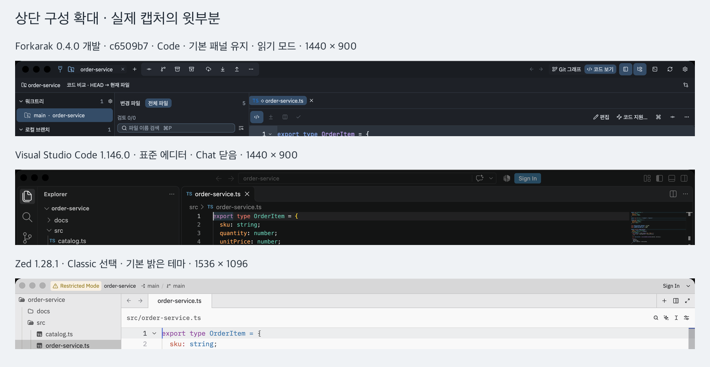

# Actual editor comparison

기본 Code 화면은 VS Code·Zed Classic보다 아직 복잡해 보입니다. Forkarak·VS Code는 실제 1440×900, Zed는 1536×1096이며 기본 테마·글꼴을 유지했습니다. Git 사이드바 숨김은 별도의 사용자 배치이고 기본 비교를 대체하지 않습니다.

[전체 비교 PNG](comparison.png) · [상단 확대 PNG](toolbar-comparison.png) · [사이드바 숨김 선택 배치](forkarak-sidebar-hidden-labeled.png) · [촬영 조건 JSON](capture-conditions.json)

Forkarak's default Code view still looks busier than VS Code standard editor and Zed Classic. Its compact reader commands do stay on one row, but four horizontal bands remain: app titlebar, worktree/comparison context, file tabs, and reader commands. The other two use titlebar/tabs/file-path bands with less command density.

Forkarak also keeps two left columns: Git worktree/ref navigation plus the file tree. VS Code has one Explorer beside its activity bar; Zed Classic has one project panel. Forkarak repeats project/worktree and comparison context in the title/context row, sidebar and footer. This benefits immediate Git access but costs visual simplicity and code width. Its stable code colors and readable default font are strengths; they do not establish a cleaner overall layout.

The optional existing Git-sidebar toggle makes Forkarak much lighter, leaving file tree plus editor. That capture is explicitly labeled as a user layout change and is never substituted for the default comparison. No source or defaults were changed.

Capture conditions: Forkarak 0.4.0 development c6509b7 and VS Code 1.146.0 actually1440x900 logical; Zed1.28.1 Classic actually1536x1096. Zed was not resized, so no precise cross-app usable-area percentages are claimed. Each app retains default font/theme (Zed uses the environment's light appearance). Fresh profiles, no sign-in/provider/plugin setup. VS Code welcome was closed and Chat hidden for the requested standard editor layout; CUA-induced accessibility prompt answered No. Both external editors remained in Restricted Mode. Forkarak's actual Git startup was captured separately, then Code / All files / the shared source were selected. Both default panels and read-before-Edit were preserved. No language trust/import/build was granted. The same authored Git fixture remained clean and had no remote. TeamViewer PID8474 remained frontmost before and after.

Primary readable3-panel PNG: comparison.png. Horizontal overview: comparison-overview.png. Actual toolbar crops: toolbar-comparison.png. Full captures and exact provenance: capture-conditions.json. Image processing only resizes/pads/captions actual native screenshots; there is no generated or reconstructed UI.

Evidence-supported proposals only: consider an editor-specific Git sidebar policy and consolidate repeated worktree/comparison context. These are review findings, not implemented changes or an authorization to alter defaults.

[Readable stacked comparison](comparison.png) · [Three-column overview](comparison-overview.png) · [Toolbar close-ups](toolbar-comparison.png) · [Optional user layout: Git sidebar hidden](forkarak-sidebar-hidden-labeled.png) · [Exact capture conditions](capture-conditions.json)

[Actual Forkarak Git startup](forkarak-startup-git.png) is separate from the Code comparison. Original full-resolution captures: [Forkarak](forkarak-native.png), [VS Code](vscode-native.png), [Zed Classic](zed-native.png).
